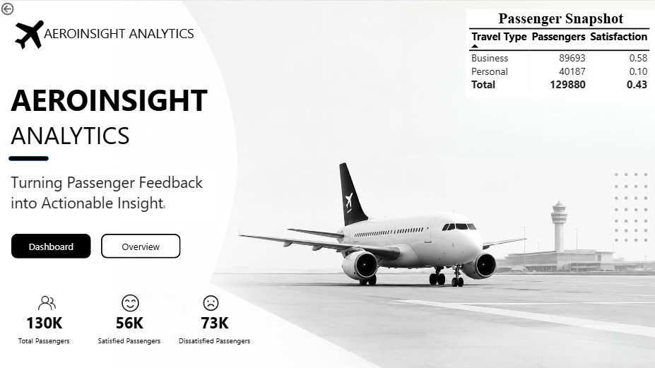
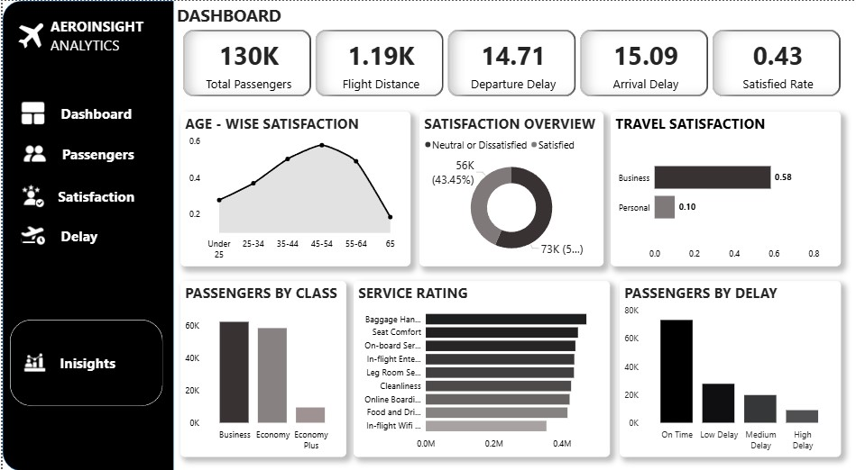

# AeroInsight Analytics | Power BI

## Project Overview

AeroInsight Analytics is an interactive Power BI dashboard designed to analyze airline passenger satisfaction, travel experience, and flight delays.

The dashboard presents key performance indicators and visual insights to explore passenger satisfaction across travel types, age groups, passenger classes, service ratings, and delay categories.

## Dashboard Screenshots

### 1. Overview Page

The overview page introduces the project and highlights important passenger metrics, including total passengers, satisfied passengers, and dissatisfied passengers.

### 2. Passenger Analytics Dashboard

The main dashboard provides a detailed view of passenger satisfaction and travel performance through KPI cards, charts, and comparisons.

## Key Performance Indicators (KPIs)

- **Total Passengers:** 130K
- **Flight Distance:** 1.19K
- **Average Departure Delay:** 14.71
- **Average Arrival Delay:** 15.09
- **Satisfaction Rate:** 0.43

## Key Features

- Passenger satisfaction analysis by age group.
- Comparison of satisfaction between business and personal travel.
- Passenger distribution across Business, Economy, and Economy Plus classes.
- Analysis of passenger ratings for different airline services.
- Passenger delay analysis across on-time, low, medium, and high delay categories.
- KPI cards for monitoring overall passenger and flight performance.

## Tools Used

- Microsoft Power BI
- Data Visualization
- Interactive Dashboard Design

This project demonstrates how Power BI can be used to transform airline passenger data into an interactive dashboard. The visualizations provide an overview of passenger satisfaction, service ratings, travel classes, and flight delays.

